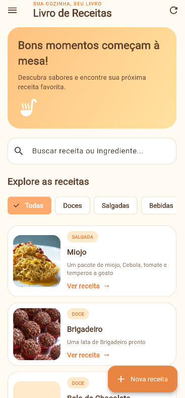
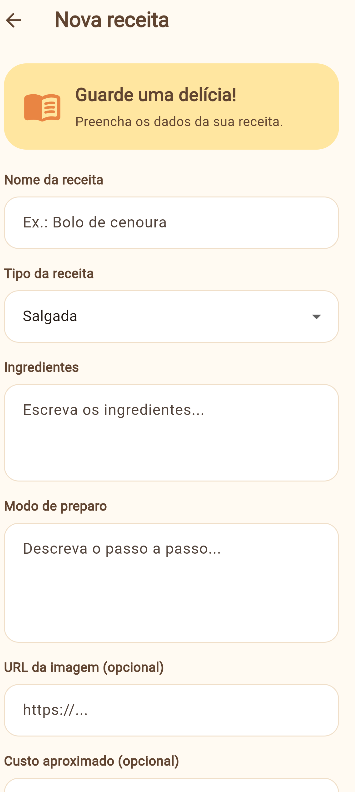
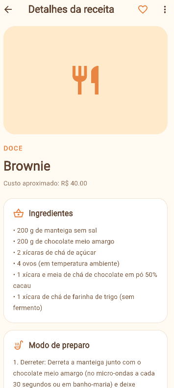

#  Livro de Receitas

##  Sobre o projeto

O Livro de Receitas é um aplicativo desenvolvido com Flutter e Dart, com o objetivo de facilitar a visualização, consulta e cadastro de receitas culinárias. O projeto foi desenvolvido durante os estudos de Desenvolvimento de Sistemas.

##  Funcionalidades

- Visualização das receitas na tela inicial.
- Consulta de receitas disponíveis.
-  Cadastro de novas receitas.
-  Carregamento de imagens por URL.
- Visualização dos ingredientes e detalhes das receitas.
-  Integração com API.
-  Interface personalizada com tons de amarelo, laranja e marrom.

##  Tecnologias utilizadas

- Flutter
- Dart
- HTTP
- API REST
- Material Design

## Telas do aplicativo

### Tela inicial



### Cadastro de receitas



### Detalhes da receita



## API utilizada

API de receitas: https://receitasapi-b-2025.vercel.app/

## Como executar o projeto

### 1. Clonar o repositório

```bash
git clone URL_DO_SEU_REPOSITORIO
```

### 2. Entrar na pasta do projeto

```bash
cd nome_da_pasta
```

### 3. Instalar as dependências

```bash
flutter pub get
```

### 4. Executar o aplicativo

```bash
flutter run
```

Para executar no Google Chrome:

```bash
flutter run -d chrome
```

## Estrutura do projeto

```text
lib/
├── main.dart
├── models/
│   └── receita.dart
├── screens/
├── services/
├── theme/
└── widgets/
```

##  Objetivo acadêmico

Desenvolver conhecimentos em Flutter, Dart, consumo de APIs, criação de interfaces e organização de projetos mobile.

## Desenvolvedora

**Livia Morais Pereira**

Estudante de Desenvolvimento de Sistemas.

---

Projeto desenvolvido para fins educacionais.
